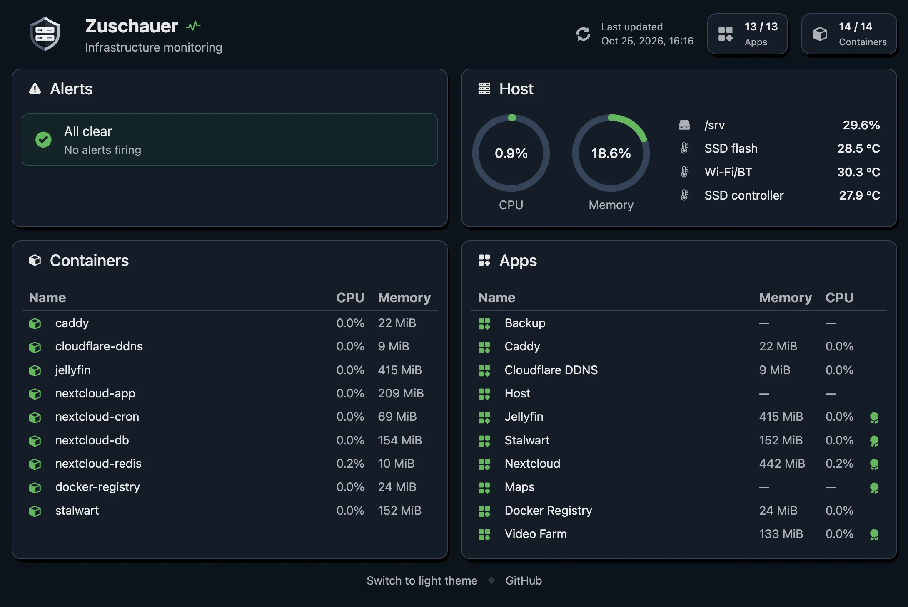

# Zuschauer

A self-contained monitoring server for a single machine. It watches the host,
its Docker containers and the apps running on it, keeps a short history in
memory, shows everything on a built-in web dashboard and sends notifications
when something goes wrong.



## Why

- **One binary.** A single executable (~3 MiB) file with the web UI built in. No
  database, no agents, no exporters.
- **One config file.** JSON with comments. `zuschauer --check` validates it and
  prints it back with every default filled in.
- **Lightweight.** Written to be fast and to eat as little as possible: almost
  zero CPU and under 5 MiB of RAM.
- **Linux, FreeBSD and macOS.** Built for a home server or a single VPS; runs
  on a laptop too.
- **No root needed.** Runs as its own unprivileged user.

## What it watches

| Area | What | Docs |
| --- | --- | --- |
| Host | CPU, memory, storage, temperature sensors (Linux, FreeBSD) | [host](docs/host.md) |
| Docker | Every container's status, CPU and memory; Podman works too, and so do jails on FreeBSD | [apps](docs/apps.md) |
| Apps | A named group of containers, HTTP health checks, TLS certificates, systemd, launchd or rc.d services and scheduled jobs | [apps](docs/apps.md) |
| Alerts | "Above X for Y" thresholds, severities, alerts that wait for others | [alerts](docs/alerts.md) |
| Notifications | [ntfy](https://ntfy.sh) | [notifiers](docs/notifiers.md) |
| Heartbeat | A regular request to a service like healthchecks.io, so you learn when the machine itself is down | [heartbeat](docs/heartbeat.md) |

## Quick start

Build it (Rust 1.89 or newer):

```sh
cargo build --release
```

Write a `config.jsonc`:

```jsonc
{
  // The dashboard's address.
  "listen": "127.0.0.1:9101",
  // Names this machine in notifications. Defaults to the hostname.
  "context": "Home server",
  "host": {
    "cpu": {
      "every": "30s",
      // Alert when the load stays above 85% for 10 minutes.
      "alert": { "above": "85%", "for": "10m" }
    },
    "storage": {
      "mounts": {
        "/": { "alert": { "above": "90%", "for": "10m" } }
      }
    }
  },
  // Finds the Docker or Podman socket on its own.
  "docker": { "every": "1m" },
  "apps": {
    "blog": {
      "name": "Blog",
      "containers": { "blog-db": { "alert": {} } },
      "healthChecks": [{ "url": "https://example.com/health", "alert": {} }],
      "certificates": { "example.com": { "alert": {} } }
    }
  },
  "notifiers": {
    "phone": { "type": "ntfy", "topic": "my-server-alerts-7f3k2q" }
  }
}
```

Run it and open <http://127.0.0.1:9101>:

```sh
./target/release/zuschauer config.jsonc
```

To keep it running in the background, see [installation](docs/installation.md).

## Command line

```text
zuschauer [CONFIG]           run, with CONFIG defaulting to ./config.jsonc
zuschauer --check [CONFIG]   validate the config, print it with defaults applied, and exit
zuschauer --state [CONFIG]   read everything the config watches once, print it, and exit
  --only PARTS               with --state, only some of: host, containers, checks, certificates, services
zuschauer --sensors          list temperature sensors with their current readings, and exit
```

## Documentation

- [Installation](docs/installation.md): building, cross-compiling, running as a
  systemd, launchd or rc.d service.
- [Configuration](docs/configuration.md): the file format, durations,
  percentages and temperatures, top-level settings.
- [Host](docs/host.md): CPU, memory, storage and temperature.
- [Apps](docs/apps.md): containers, health checks, certificates, services and
  jobs.
- [Alerts](docs/alerts.md): thresholds, severities, dependencies, firing and
  resolving.
- [Notifiers](docs/notifiers.md): sending alerts to ntfy.
- [Heartbeat](docs/heartbeat.md): letting an outside service know zuschauer is
  alive.
- [Dashboard](docs/dashboard.md): the dashboard, the details dialogs, themes.
- [Development](docs/development.md): building, testing, git hooks.

## The name

*Zuschauer* is German for "spectator" or "onlooker": someone who watches. It
comes from *zuschauen*, "to watch", from *zu* ("at") and *schauen* ("to look").

It's pronounced **TSOO-show-er** ([ˈtsuːʃaʊ̯ɐ]): the German *z* sounds like the
*ts* in "cats", and the final *-er* is a soft, unstressed "uh".

## License

MIT with the [Commons Clause](https://commonsclause.com): free to use, modify
and build on, commercially too, but not to sell. See [LICENSE](LICENSE).
