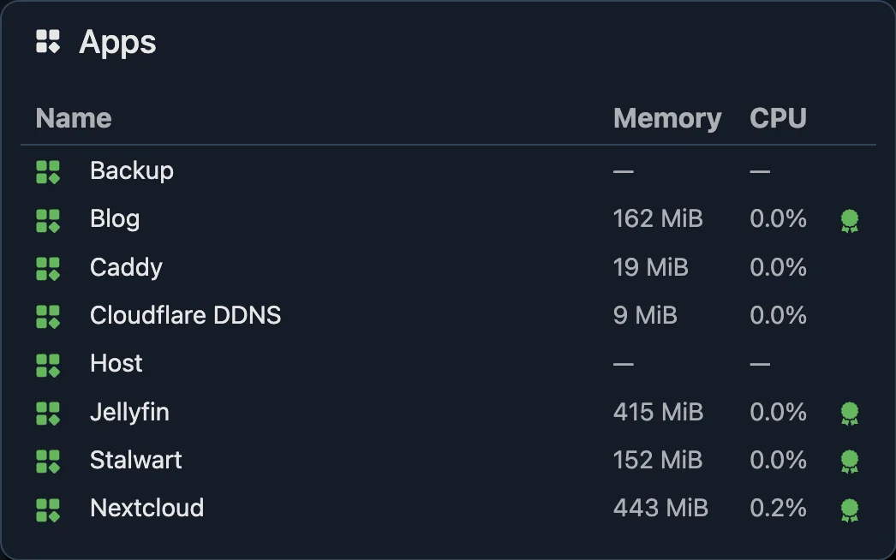
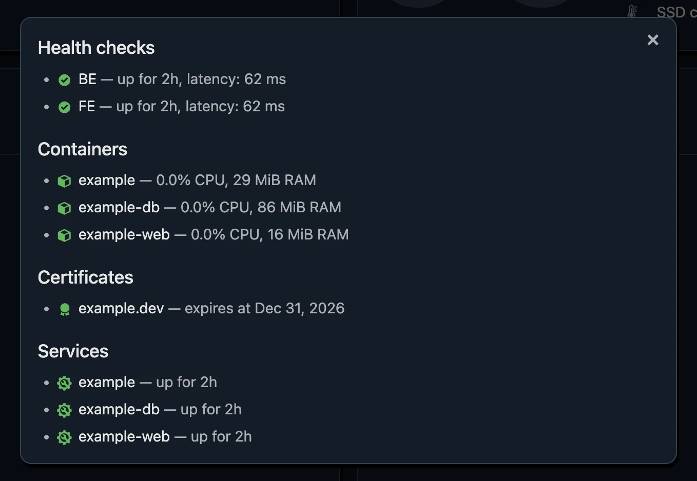

# Apps

An app is a named group of everything one service of yours depends on: its
containers, the URLs it answers on, its TLS certificates, the system services
it runs as, commands that check it, and its scheduled jobs. Each app gets a row
on the dashboard with one overall status:



Clicking the row opens a dialog with each part:



- [Overview](#overview)
- [Apps](#apps-1)
- [Containers](#containers)
- [Health checks](#health-checks)
- [Certificates](#certificates)
- [Services](#services)
- [Commands](#commands)
- [Jobs](#jobs)
- [Alerts](#alerts)

## Overview

```jsonc
"docker": { "every": "30s" },

"certificates": { "every": "6h", "warnBefore": "14d" },
"services": { "every": "30s" },

"apps": {
  "blog": {
    "name": "Blog",
    "containers": {
      "blog-web": { "alert": { "for": "5m" } },
      "blog-db": { "alert": { "for": "5m", "id": "blog-db", "severity": "critical" } }
    },
    "healthChecks": [
      {
        "name": "site",
        "url": "https://example.com/",
        "every": "1m",
        "contentType": "text/html",
        "alert": { "for": "5m", "dependsOn": ["blog-db"] }
      }
    ],
    "certificates": {
      "example.com": { "alert": {} }
    },
    "services": {
      "nginx.service": { "alert": { "for": "5m" } }
    },
    "commands": {
      "queue": {
        "run": ["/usr/local/bin/check-queue", "--max", "100"],
        "every": "5m",
        "alert": {}
      }
    },
    "jobs": {
      "backup": {
        "token": "change-me-to-a-long-random-string",
        "schedule": "0 3 * * *",
        "maxDuration": "2h",
        "alert": { "for": "15m" }
      }
    }
  }
}
```

An app needs at least one part. Use only the parts you need: an app can be a
single health check.

## Apps

`apps` is keyed by the app's ID:

| Key | Default | |
| --- | --- | --- |
| `name` | the ID | What the dashboard and notifications call it. |
| `containers` | none | See [containers](#containers). |
| `healthChecks` | none | See [health checks](#health-checks). |
| `certificates` | none | See [certificates](#certificates). |
| `services` | none | See [services](#services). |
| `commands` | none | See [commands](#commands). |
| `jobs` | none | See [jobs](#jobs). |

The ID is part of the jobs' URLs, so an app with jobs needs an ID of letters,
digits, `.`, `_` and `-`.

## Containers

Containers the app runs, by name. Needs a top-level `docker` section, which
turns container monitoring on:

```jsonc
"docker": {
  "every": "30s"
},
"apps": {
  "blog": {
    "containers": {
      "blog-web": {},
      "blog-db": { "alert": { "for": "5m" } }
    }
  }
}
```

| Key | Default | |
| --- | --- | --- |
| `docker.every` | `"1m"` | How often containers are read. Shared by all apps. |
| `docker.socket` | found automatically | See [the Docker socket](installation.md#the-docker-socket). |
| `alert` | none | A [state alert](#alerts). |

The name is the one the Containers panel shows: the container's name, or the
systemd unit's name for containers run by Quadlet. Docker and Podman both
work, rootful or rootless, see [container names](installation.md#container-names-on-linux).
On FreeBSD, containers are jails, named as `jls name` shows them, and Podman's
containers by their Podman name, see [container names on
FreeBSD](installation.md#container-names-on-freebsd).

A container is fine while it's running. Paused, stopped, removed, or never
seen since zuschauer started all count as problems. Jails can't be paused, and
a stopped jail no longer exists, so it shows as gone, like a removed container.

Each container's CPU and memory are graphed, and the app's row shows their sum.
Containers that aren't part of any app still appear in the Containers panel,
just without alerts.

## Health checks

HTTP requests to the app, each checking the response's status code and,
optionally, its content type:

```jsonc
"healthChecks": [
  {
    "name": "api",
    "url": "https://example.com/api/health",
    "every": "1m",
    "timeout": "5s",
    "expectCode": 200,
    "contentType": "application/json",
    "alert": { "for": "2m" }
  }
]
```

| Key | Default | |
| --- | --- | --- |
| `url` | required | An `http://` or `https://` URL. |
| `name` | the URL | What the dashboard and notifications call it. Two checks of one app can't share a name. |
| `every` | `"1m"` | How often the request is sent. |
| `timeout` | `"10s"`, or `every` if shorter | How long one request may take before it counts as failed. Can't be longer than `every`. |
| `expectCode` | `200` | The status code that means healthy. |
| `contentType` | any | Text the `Content-Type` header must contain, ignoring case. `"text/html"` matches `text/html; charset=utf-8`. |
| `alert` | none | A [state alert](#alerts). |

How the request works:

- It's a `GET`, and only the status line and headers are read, not the body.
- **Redirects aren't followed.** A URL that redirects returns `301` or `302`;
  either point the check at the final URL or set `expectCode` to the redirect.
- HTTPS certificates are verified against the OS's trusted certificates, so a
  broken certificate fails the check too.
- The response time of the last successful check is shown in the app's
  dialog.

The `contentType` check catches a common failure: a reverse proxy answering
`200` with its own HTML error page while the API behind it is down.

## Certificates

TLS certificates to watch for expiry, keyed by host:

```jsonc
"certificates": {
  "every": "6h",
  "warnBefore": "14d"
},
"apps": {
  "blog": {
    "certificates": {
      "example.com": { "alert": {} },
      "mail.example.com:993": { "alert": { "severity": "critical" } }
    }
  }
}
```

| Key | Default | |
| --- | --- | --- |
| `certificates.every` | `"6h"` | How often certificates are checked. Shared by all apps. |
| `certificates.warnBefore` | `"14d"` | How long before expiry it becomes a problem. Shared by all apps. |
| `alert` | none | A [state alert](#alerts). |

The key is `host` or `host:port`, without `https://` or a path. The port
defaults to `443`; give another one for other TLS services, like IMAP on
`993`.

A certificate is a problem when:

- it expires within `warnBefore`;
- the check fails: no connection, no answer within 10 seconds, or a handshake
  that fails. An expired certificate, one not trusted by the OS, or one for
  another host name all fail the handshake.

Six hours is plenty: the point is to notice a renewal that stopped working,
weeks before the certificate actually expires.

## Services

System services the app runs as, by name:

```jsonc
"services": {
  "every": "1m"
},
"apps": {
  "blog": {
    "services": {
      "nginx.service": {
        "alert": { "for": "5m", "restarts": { "above": 3, "within": "1h" } }
      }
    }
  }
}
```

| Key | Default | |
| --- | --- | --- |
| `services.every` | `"1m"` | How often services are checked. Shared by all apps. |
| `alert` | none | A [state alert](#alerts), plus `restarts`, see below. |

The name depends on the OS:

- **Linux:** a systemd system unit, as `systemctl` knows it: `nginx.service`,
  `backup.timer`. All services are checked in one `systemctl show` call.
- **macOS:** a launchd label, like `com.example.agent`. It's looked up in your
  user's domain first, then in the system's. To pick the domain yourself, write
  the full target: `gui/501/com.example.agent`, `system/com.example.daemon`.
- **FreeBSD:** an rc.d script's name, as `service` knows it: `nginx`, `sshd`.
  Each one is checked with `service <name> onestatus`, so it doesn't have to be
  enabled in `rc.conf`.

A service is fine while it's running. Stopped, starting, stopping, failed,
restarting, or not found all count as problems, with the reason shown, such
as "failed, exit code 1". On Linux, a `oneshot` unit (one that runs and exits)
is only a problem when its last run failed. On FreeBSD a few services can't be
checked at all: a script without a status command, and one whose pid file
zuschauer can't read, which shows as "can't check it", see [services on
FreeBSD](installation.md#services-on-freebsd).

### Restart loops

A service that crashes and is restarted by systemd every few seconds can look
"running" at every check. `restarts` catches that:

```jsonc
"alert": {
  "for": "1m",
  "restarts": { "above": 3, "within": "1h" }
}
```

This fires when the service restarted more than 3 times within the last hour,
right away, without waiting for `for`. `within` can't be shorter than
`services.every`, since restarts are counted between checks. Once the count
passes half the limit, the app's dialog shows it, like "2 of 3 restarts in
1h".

On FreeBSD rc.d doesn't restart services, so there's nothing to count:
`restarts` is rejected there.

## Jobs

Scheduled jobs, such as a nightly backup, that report to zuschauer when they
start and finish. Zuschauer knows the schedule, so it also notices a job that
never started.

```jsonc
"jobs": {
  "backup": {
    // Generate one, e.g. with `openssl rand -hex 16`.
    "token": "change-me-to-a-long-random-string",
    "schedule": "0 3 * * *",
    "maxDuration": "2h",
    "alert": { "for": "15m", "severity": "critical" }
  }
}
```

| Key | Default | |
| --- | --- | --- |
| `token` | required | A secret the job sends with each report. At least 16 characters, no spaces. |
| `schedule` | required | When it's due, as a cron expression, see below. |
| `maxDuration` | until it's next due | How long a run may take before it counts as hung. |
| `alert` | none | A [state alert](#alerts). |

The job name, like the app's ID, is part of the URLs: letters, digits, `.`,
`_` and `-`.

### Schedules

The standard five `cron` fields, in the server's local time:

```text
┌───────── minute (0-59)
│ ┌─────── hour (0-23)
│ │ ┌───── day of month (1-31)
│ │ │ ┌─── month (1-12 or jan-dec)
│ │ │ │ ┌─ day of week (0-7, Sunday is 0 or 7, or sun-sat)
│ │ │ │ │
0 3 * * *
```

Lists (`1,15`), ranges (`1-5`) and steps (`*/10`) work, as do `@hourly`,
`@daily`, `@weekly`, `@monthly` and `@yearly`.

This is the job's schedule as zuschauer expects it, not something zuschauer
runs. The job itself still runs from cron, a systemd timer, or anything else.

### Reporting runs

A job reports with three `POST` requests, each with its token:

| URL | When |
| --- | --- |
| `/jobs/<app>/<job>/start` | the run starts |
| `/jobs/<app>/<job>/ok` | it succeeded |
| `/jobs/<app>/<job>/fail` | it failed |

For example, a backup script:

```sh
#!/bin/sh
URL=http://127.0.0.1:9101/jobs/blog/backup
AUTH="Authorization: Bearer $BACKUP_TOKEN"

curl -fsS -X POST -H "$AUTH" "$URL/start"
if /usr/local/bin/backup; then
  curl -fsS -X POST -H "$AUTH" "$URL/ok"
else
  curl -fsS -X POST -H "$AUTH" "$URL/fail"
fi
```

The answers:

| Status | Means |
| --- | --- |
| `200` | Recorded. |
| `401` | The token is missing or wrong. |
| `404` | No such app or job, or the event isn't `start`, `ok` or `fail`. |
| `409` | `ok` or `fail` without a `start` before it. |

### What counts as a problem

| State | When | Fires |
| --- | --- | --- |
| Late | it was due, but no `start` came | after the alert's `for` |
| Hung | it's still running after `maxDuration`, or when it's due again if there's no `maxDuration` | at once |
| Failed | the last run reported `fail` | at once, and stays until a run succeeds |

The alert's `for` works as a grace period for late starts: with `"for": "15m"`,
a job due at 03:00 can start as late as 03:15 without an alert.

A few more rules:

- A `start` while a run is open replaces it, as if the earlier run got lost.
- A failure stays the reason even while the job is retried or misses its next
  start. Only a successful run clears it.
- Zuschauer doesn't remember runs across restarts. After a restart, it waits
  for the next due time.

## Alerts

Every part of an app takes the same kind of alert: it fires when the part
stays in trouble for at least `for`.

```jsonc
"alert": {
  "for": "2m",
  "severity": "critical",
  "id": "blog-db",
  "dependsOn": ["some-other-alert"]
}
```

| Key | Default | |
| --- | --- | --- |
| `for` | `"0s"` | How long a problem must last. Without it, the first failed check fires. |
| `severity` | `"warning"` | `"critical"`, `"warning"` or `"info"`. |
| `id` | generated | A name for `dependsOn` to refer to. |
| `dependsOn` | none | IDs of alerts that make this one wait. |

An empty `{}` is a valid alert with every default:

```jsonc
"certificates": { "example.com": { "alert": {} } }
```

A part without `alert` is still watched and shown on the dashboard; it just
never notifies.

Some problems fire at once, without waiting for `for`, because waiting
wouldn't make them better: a [restart loop](#restart-loops), and a hung or
failed [job](#what-counts-as-a-problem).

`dependsOn` keeps the noise down when one failure causes others. If the
health check depends on the database container's alert, a dead database sends
one notification instead of two. Give the alert it depends on an `id` of your
own, as `blog-db` above.

See [alerts](alerts.md) for how alerts fire, resolve, depend on each other and
reach you.
