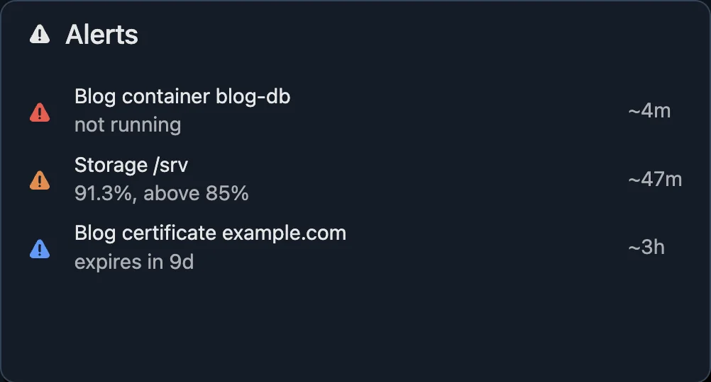
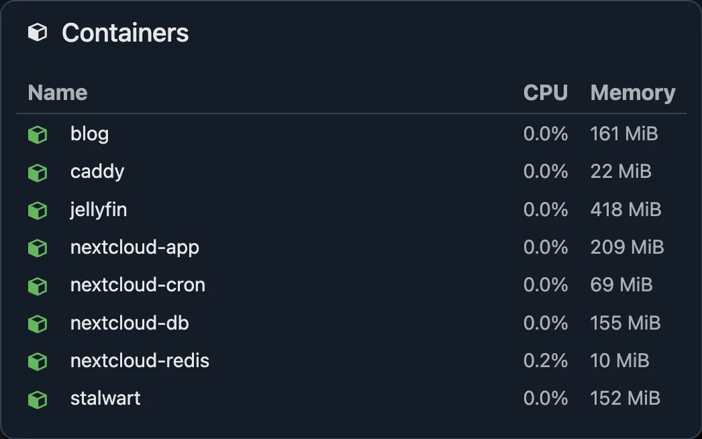
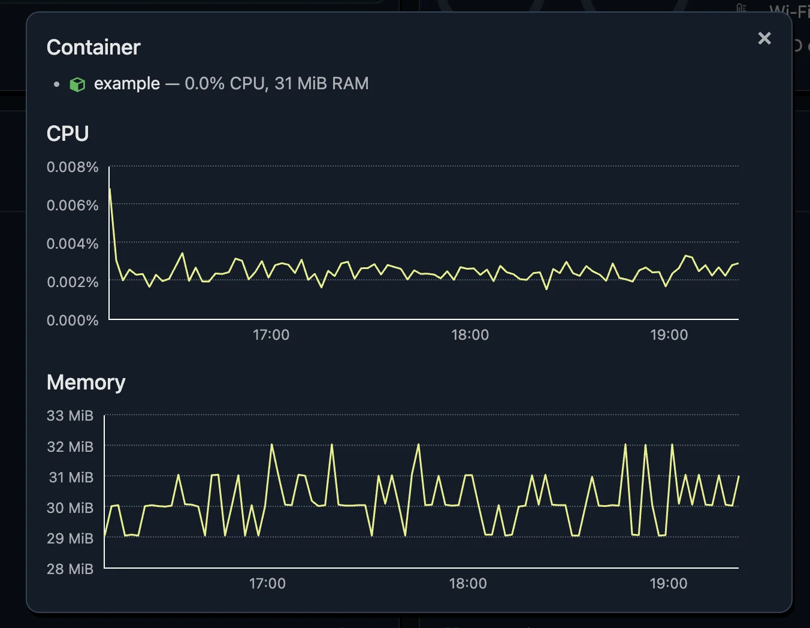

# Dashboard

Zuschauer serves a dashboard at its `listen` address,
`http://127.0.0.1:9101` by default.

## A snapshot, not a live view

The dashboard is deliberately simple: each page is rendered on the server
when you load it, and **shows the state at that moment**. Nothing updates on
its own. The header shows when the page was rendered; reload the page, or
press the reload button beside it, to see what changed.

The same goes for the details dialogs: a dialog shows the state at the moment
you opened it. Close and open it again to refresh it.

## What's on it

- **Header:** the [heartbeat](heartbeat.md) indicator, when the page was
  rendered, and how many apps, and how many of their containers, are fine.
- **Alerts:** the [alerts](alerts.md) firing right now, colored by severity,
  with how long their problems have lasted. "All clear" when none are.

  

- **Host:** CPU, memory, storage and temperatures, see [host](host.md).

  

- **Containers:** every container zuschauer sees, with its CPU and memory,
  whether it belongs to an app or not. Click one to see its CPU and memory
  graphs.

  

  

- **Apps:** each [app](apps.md) with its overall status. Click one to see each
  of its parts.

  

  

Hover an icon or a value for more details, like why something is a problem.

## Themes

The dashboard follows your OS's light or dark theme. The link at the bottom of
the page switches to the other one, and the browser remembers your choice.

## Access

The dashboard has no login: anyone who can reach it can see everything on it.
Keep it on `127.0.0.1` and reach it through an SSH tunnel, a VPN, or a reverse
proxy with authentication, see
[exposing the dashboard](installation.md#exposing-the-dashboard).
