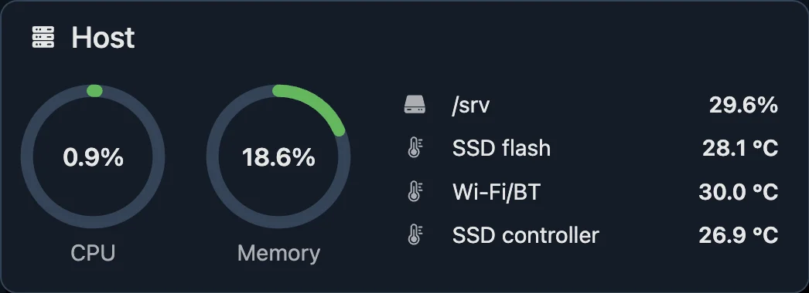

# Host

The `host` section watches the machine itself: CPU, memory, disk space and
temperature sensors.



- [Overview](#overview)
- [CPU](#cpu)
- [Memory](#memory)
- [Storage](#storage)
- [Temperature](#temperature)
- [Threshold alerts](#threshold-alerts)

## Overview

```jsonc
"host": {
  "cpu": {
    "every": "10s",
    "alert": { "above": "85%", "for": "10m" }
  },
  "memory": {
    "every": "10s",
    "alert": { "above": "90%", "for": "5m" }
  },
  "storage": {
    "every": "1m",
    "mounts": {
      "/": { "alert": { "above": "85%", "for": "10m" } }
    }
  },
  "temperature": {
    "nvme/Composite": {
      "name": "NVMe",
      "alert": { "above": "70C", "for": "10m" }
    }
  }
}
```

| What | Linux | macOS | FreeBSD | Watched without config |
| --- | --- | --- | --- | --- |
| CPU | yes | yes | yes | yes, every minute |
| Memory | yes | yes | yes | yes, every minute |
| Storage | yes | yes | yes | no: list the mounts you care about |
| Temperature | yes | no | yes | no: list the sensors you care about |

Nothing here needs root, see [permissions](installation.md#permissions).

## CPU

The share of all cores that was busy, as an average over each `every`
interval. 100% means every core was busy the whole time.

```jsonc
"cpu": {
  "every": "10s",
  "alert": { "above": "85%", "for": "10m" }
}
```

| Key | Default | |
| --- | --- | --- |
| `every` | `"1m"` | How often it's measured, and the window each value averages over. |
| `alert` | none | A [threshold alert](#threshold-alerts) with a percentage. |

A shorter `every` catches short spikes in the graph; a longer one smooths them
out. Either way, the alert only fires if the load stays high for the whole
`for`, so a short `every` doesn't make alerts noisier.

On Linux it's read from `/proc/stat`, on FreeBSD from the `kern.cp_time`
sysctl.

## Memory

The share of RAM that programs actually hold. Cache the system can drop at any
moment doesn't count, so a machine with "full" RAM from file caching shows its
real usage, not 99%.

```jsonc
"memory": {
  "every": "10s",
  "alert": { "above": "90%", "for": "5m" }
}
```

| Key | Default | |
| --- | --- | --- |
| `every` | `"1m"` | How often it's measured. |
| `alert` | none | A [threshold alert](#threshold-alerts) with a percentage. |

Where the numbers come from:

- **Linux:** `MemTotal` minus `MemAvailable` from `/proc/meminfo`, the kernel's
  own estimate of what's free for new programs.
- **macOS:** what Activity Monitor calls "Memory Used": app memory, wired and
  compressed memory. File cache and purgeable memory are left out.
- **FreeBSD:** has no estimate like `MemAvailable`, so zuschauer adds it up from
  sysctls, out of `hw.physmem`. Used is the kernel's own wired memory, minus
  the caches it can give back (the buffer cache and the shrinkable part of
  ZFS's ARC), plus the anonymous memory of programs that's in RAM: what would
  go to swap under pressure. Program memory counts whether it's active,
  inactive or locked; file cache doesn't count wherever it is.

## Storage

Used space of each filesystem you list, the same percentage `df` shows.

```jsonc
"storage": {
  // The default for every mount below.
  "every": "1m",
  "mounts": {
    "/": {
      "alert": { "above": "85%", "for": "10m" }
    },
    "/srv/backups": {
      // A mount's own `every` wins over the default.
      "every": "10m",
      "alert": { "above": "95%", "for": "1h" }
    }
  }
}
```

| Key | Default | |
| --- | --- | --- |
| `every` | `"1m"` | How often each mount is measured, unless it sets its own. |
| `mounts` | none | Keyed by path. Each takes its own `every` and `alert`. |

About the paths:

- **Any existing directory works**, it doesn't have to be a mount point. It
  reports the whole filesystem that holds it. `"/srv/backups"` on the root
  filesystem reports the same as `"/"`.
- **Paths must be absolute and exist** when zuschauer starts, or the config is
  rejected.
- **It's instant**, however many files there are: it reads the filesystem's
  own counters instead of walking the files.

Like `df`, 100% means ordinary programs can't write anymore. Most Linux
filesystems keep a few percent reserved for root, so a disk at 100% may still
have space only root can use.

## Temperature

Hardware sensors: CPU, NVMe drives, the board, and whatever else the drivers
report. They come from the kernel's `hwmon` interface on Linux, and from
sysctls on FreeBSD. macOS has neither.

### Finding sensor names

List the sensors and their current readings:

```sh
zuschauer --sensors
```

```text
"cpu_thermal/temp1"     48.3C
"nvme/Composite"        41.9C
"nvme/Sensor 1"         41.9C
"nvme/Sensor 2"         44.9C
```

On Linux, each name is `driver/label`, already quoted the way the config wants
it. A sensor without a label is named after its file, like `temp1`. These
names stay the same across reboots, unlike the `hwmonN` directories they come
from.

On FreeBSD, each name is the sysctl it's read from. Any temperature under
`dev` or `hw.acpi` is listed:

```text
"dev.cpu.0.temperature"            52.0C
"dev.cpu.1.temperature"            50.0C
"hw.acpi.thermal.tz0.temperature"  27.9C
```

CPU temperatures need the driver for your CPU loaded, `coretemp` for Intel or
`amdtemp` for AMD. Load it now with `kldload coretemp`, and on every boot with
`coretemp_load="YES"` in `/boot/loader.conf`. ACPI's limits, like
`hw.acpi.thermal.tz0._CRT`, are temperatures too and show up in the list, but
they're fixed values, not readings.

### Watching sensors

Copy the names you want into `temperature`:

```jsonc
"temperature": {
  "nvme/Composite": {
    "name": "NVMe",
    "every": "30s",
    "alert": { "above": "70C", "for": "10m" }
  },
  "cpu_thermal/temp1": {
    "name": "CPU",
    "alert": { "above": "80C", "for": "5m", "resolveBelow": "70C" }
  }
}
```

| Key | Default | |
| --- | --- | --- |
| `name` | the sensor's key | What the dashboard and notifications call it. |
| `every` | `"1m"` | How often it's read. |
| `alert` | none | A [threshold alert](#threshold-alerts) in degrees Celsius. |

Sensors are matched once, at startup. A configured sensor that isn't found is
logged and shown on the dashboard as an error ("not found, see `zuschauer
--sensors`"), and so is a name that several sensors share. Neither stops
zuschauer.

## Threshold alerts

Every `alert` on this page has the same shape: it fires when the value stays
above `above` for at least `for`.

```jsonc
"alert": {
  "above": "85%",
  "for": "10m",
  "resolveBelow": "70%",
  "severity": "critical",
  "id": "cpu-hot",
  "dependsOn": ["some-other-alert"]
}
```

| Key | Required | |
| --- | --- | --- |
| `above` | yes | The threshold: a percentage, or a temperature for sensors. |
| `for` | yes | How long the value must stay above it. Can't be shorter than the metric's `every`, or a single reading would fire it. |
| `resolveBelow` | no | Once fired, the alert only resolves below this. Defaults to `above`. |
| `severity` | no | `"critical"`, `"warning"` (the default) or `"info"`. |
| `id` | no | A name for `dependsOn` to refer to, see below. |
| `dependsOn` | no | IDs of alerts that make this one wait. |

`resolveBelow` stops an alert from flapping when the value hovers around the
threshold. With `"above": "85%"` and `"resolveBelow": "70%"`, a CPU that
bounces between 84% and 86% fires once and stays fired until it really calms
down.

Give an alert an `id` when another alert's `dependsOn` refers to it. An ID you
chose stays the same when you rename a sensor or move a mount, and it reads
better in `dependsOn`:

```jsonc
"storage": {
  "mounts": {
    "/": { "alert": { "above": "85%", "for": "10m", "id": "root-disk" } }
  }
}
```

See [alerts](alerts.md) for how alerts fire, resolve, depend on each other and
reach you.